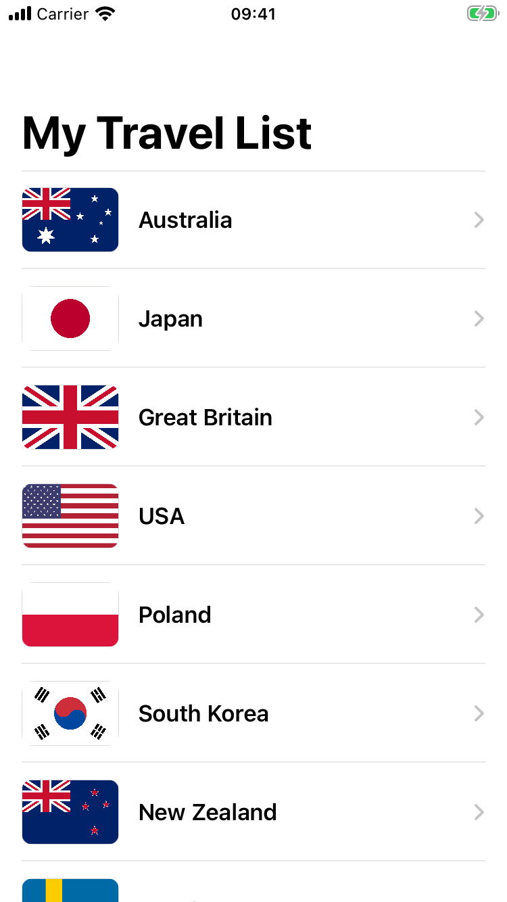
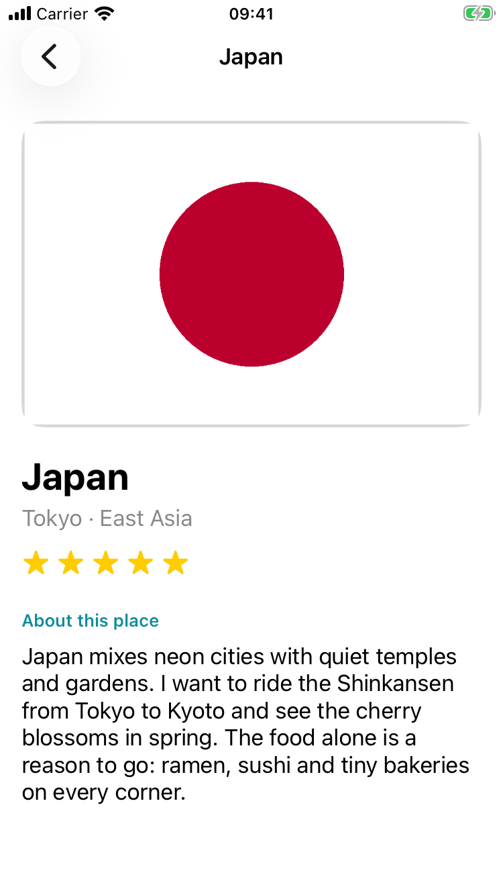
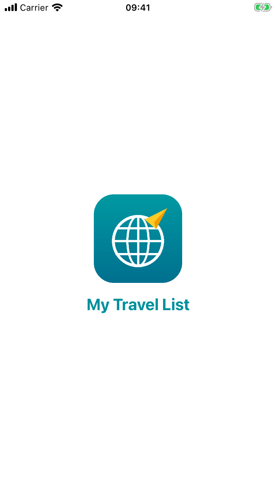
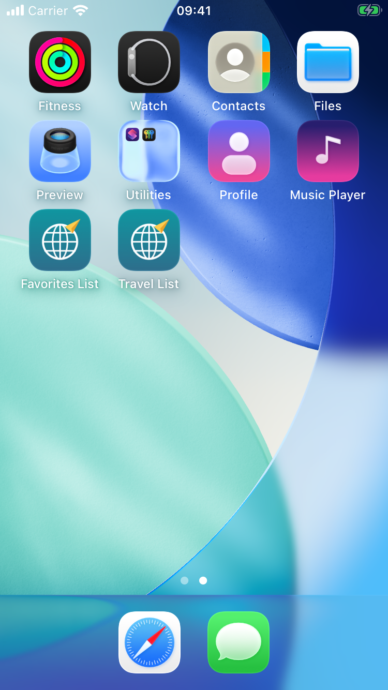
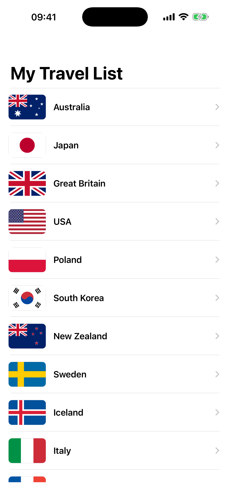
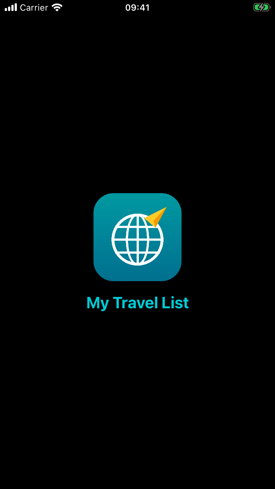

# My Travel List

Lab · Favorites Navigator — UINavigationController & Detail Screen.

**Student:** Бейсенбаева Диана  
**Theme:** countries I want to visit

A UIKit app with my travel wish list. The list of 20 countries lives inside a `UINavigationController`; each row shows the flag and the name. Tapping a row opens the Detail screen with everything about that country: a large flag, capital and region, how much I want to go there (0–5 stars) and why. Screens, navigation and layout are all built in `Main.storyboard`. This project continues my Favorites List lab.

## Screenshots

| List | Detail | Launch Screen | App Icon |
|---|---|---|---|
|  |  |  |  |

| List · iPhone 16 Pro Max | Launch Screen · Dark Mode |
|---|---|
|  |  |

## Requirements checklist

**Storyboard only**
- `Main.storyboard`: navigation controller, both screens, the segue, the navigation bar titles and all Auto Layout
- Swift: data model, table view data source, `prepare(for:sender:)` and filling outlets. No `pushViewController`, `instantiateViewController`, constraints, anchors or frames

**Theme and data**
- 20 countries; each has a title, a subtitle, a flag image, a rating 0–5 and a description of 3 sentences
- `FavoriteItem` struct, the array lives in `FavoritesLibrary.items` (`FavoriteItem.swift`)
- Every country has its own flag in `Assets.xcassets`

**List screen**
- Embedded in a `UINavigationController`, which is the initial view controller
- Title "My Travel List" with Prefers Large Titles on
- `UITableView` pinned to the Safe Area; the prototype cell shows only the flag and the name
- Cells are dequeued by the `FavoriteCell` reuse identifier and filled from the item

**Navigation and passing data**
- Show segue from the prototype cell to the Detail screen, identifier `showDetail`
- Back button and edge swipe return to the list; the tapped row is deselected on return (also follows the interactive swipe)
- Detail title = item title, small title (`Large Title: Never`)
- `DetailViewController` has one property `var item: FavoriteItem?`; the list sets it in `prepare(for:sender:)` after checking the identifier, casting `segue.destination` and reading `tableView.indexPathForSelectedRow`. The Detail screen fills its own outlets in `viewDidLoad`

**Detail screen**
- Large flag (Aspect Fill + Clips to Bounds, fixed 3:2 ratio), title, subtitle, SF Symbol rating and description (`Lines = 0`)
- Inside a scroll view, so long descriptions are never cut off on iPhone SE
- Zero Auto Layout warnings or errors

**Design**
- One style for both screens: system font, teal brand color, 16 pt margins, the same star rating

**App Icon and Launch Screen**
- Custom 1024 × 1024 PNG icon (globe + paper plane), no transparency, square corners
- `LaunchScreen.storyboard` with the icon art and the app name, centered with constraints, on the system background, so it matches the app in Light and Dark Mode

## Project structure

```
FavoritesNavigator/
├── FavoritesViewController.swift   // list: data source, prepare(for:sender:), deselect on return
├── DetailViewController.swift      // var item + filling outlets in viewDidLoad
├── FavoriteCell.swift              // flag + title
├── FavoriteItem.swift              // struct + the 20 countries
├── Assets.xcassets                 // 20 flags, AppIcon, launch logo, colors
├── Main.storyboard
└── LaunchScreen.storyboard
```

## How to run

Open `FavoritesNavigator.xcodeproj`, pick an iPhone simulator and press **⌘R**.
