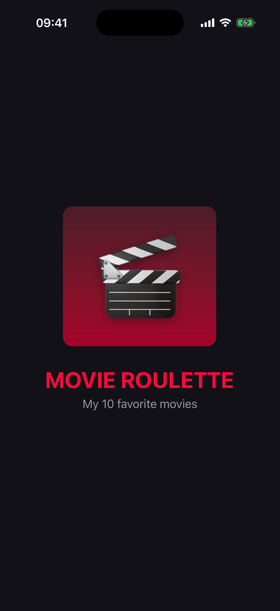
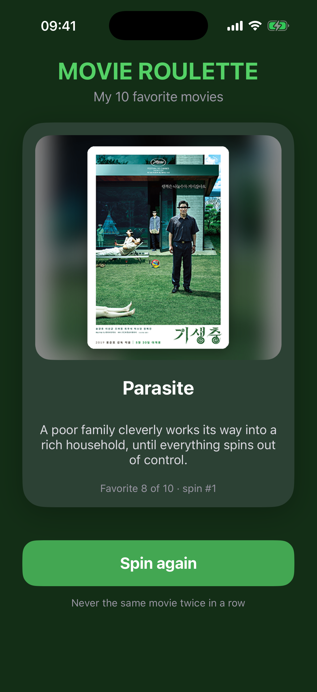
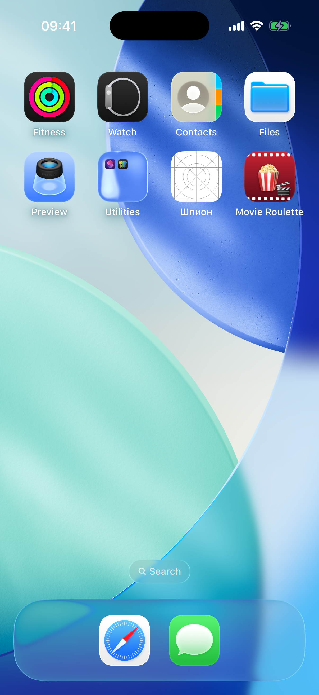

# Movie Roulette

Lab 6 · Favorites Roulette. A single-screen iOS app that shows a random card from my 10 favorite movies.

Each tap on the button shows a random favorite: image, title and description update together with a flip animation, and the whole screen takes on the movie's accent color. The same movie never appears twice in a row.

The start screen shows an animated SpongeBob GIF and the line "Spin it to see niche taste in movies" with a **Let's go** button.

## Screenshots

| Launch screen | Main screen | Home Screen |
|---|---|---|
|  |  |  |

## Requirements checklist

- iOS App, Storyboard interface, Swift. Display Name: **Movie Roulette**
- One category (movies), exactly 10 favorites, each with an image in `Assets.xcassets`, a title and a description
- Favorites are stored as an array of the `Favorite` struct (`Favorite.swift`)
- Layout in `Main.storyboard` with `UIImageView`, `UILabel` and `UIButton`, no Auto Layout constraints (frames + autoresizing masks only)
- Initial state on launch: animated GIF card "Spin it to see niche taste in movies", not empty views
- Images use Aspect Fit, so they are never stretched; long descriptions wrap and shrink to fit
- No repeats in a row: the next index is picked from all indices except the current one
- No force unwraps except `@IBOutlet` declarations
- Custom `LaunchScreen.storyboard` in the app's style, no constraints
- Custom `AppIcon`: 1024 × 1024 PNG without transparency

## My 10 movies

The Lighthouse · Tenet · Mickey 17 · A Walk to Remember · How to Lose a Guy in 10 Days · Harry Potter and the Prisoner of Azkaban · Project Hail Mary · Parasite · Dune · Remember Me

Posters: low-resolution images from the films' English Wikipedia articles, used for an educational project.

## Project structure

```
FavoritesRoulette/
├── AppDelegate.swift
├── SceneDelegate.swift
├── ViewController.swift      // outlets, spin action, no-repeat random pick, accent theme, GIF
├── Favorite.swift            // struct + the 10 favorites with accent colors
├── Main.storyboard
├── LaunchScreen.storyboard
├── Assets.xcassets           // 10 movie posters, start GIF, launch image, AppIcon
└── Info.plist
```

## How to run

Open `FavoritesRoulette.xcodeproj` in Xcode, choose an iPhone simulator and press **⌘R**.
