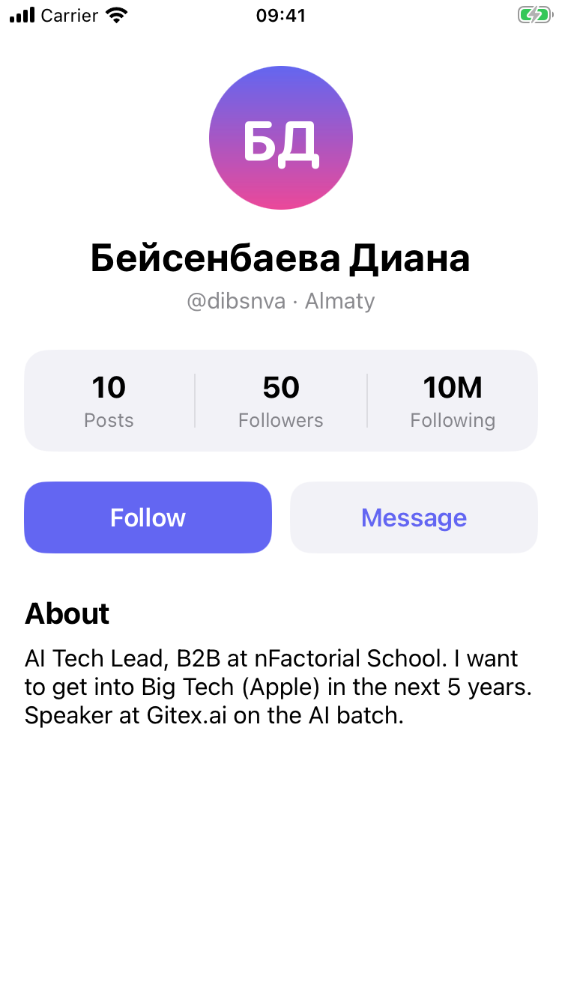
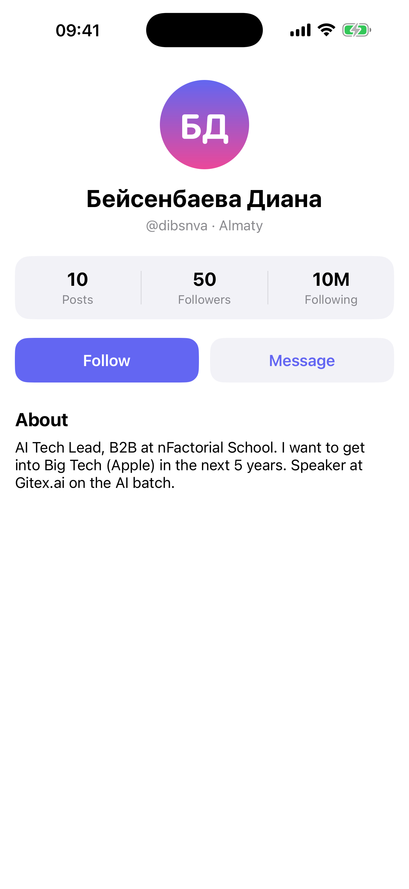

# Profile Screen

Assignment 7 · Auto Layout, **Variant A · Profile**. My profile screen built in UIKit with a Storyboard only: every view and every constraint is set in Interface Builder, without `UIStackView`. Swift only fills in the data.

## Screenshots

| iPhone SE (3rd gen) | iPhone 16 Pro Max |
|---|---|
|  |  |

**Long text test** with the name "Maximilian Alexander von Habsburg": it wraps to two lines and nothing overlaps or gets clipped.

| iPhone SE (3rd gen) | iPhone 16 Pro Max |
|---|---|
|  |  |

## Requirements checklist

**Variant A**
- Avatar: 96 × 96 (fixed width and height), centered with `centerX`, made round with the `layer.cornerRadius = 48` runtime attribute and Clip to Bounds
- Name: up to 2 lines (`Lines = 2`), centered
- Stats: 3 columns with 1 pt dividers between them; columns 2 and 3 have **Equal Widths** to column 1, the dividers are fixed 1 × 36 and centered vertically
- Follow and Message: **Equal Widths**, 12 pt between them, fixed height 48 pt, top-aligned
- About: `Lines = 0`, wraps with no limit

**Both variants**
- Side margins 16 pt; everything sits in a scroll view pinned to the Safe Area, so long About text scrolls instead of going off screen
- Content view pinned to the scroll view's Content Layout Guide and Equal Width to the Frame Layout Guide; the vertical chain of constraints goes from the avatar to the bottom of About without gaps
- No `UIStackView`, no frames, constraints or anchors in Swift
- No red or orange warnings in Interface Builder; no "Unable to simultaneously satisfy constraints" in the console. Checked on iPhone SE (3rd gen) and iPhone 16 Pro Max

## Project structure

```
ProfileScreen/
├── ProfileViewController.swift   // outlets + filling them with data, Follow/Message actions
├── Profile.swift                 // Profile struct + my data
├── Assets.xcassets               // avatar, AppIcon, accent color
├── Main.storyboard               // the whole layout
└── LaunchScreen.storyboard
```

For the long text test, change `name` in `Profile.swift` to "Maximilian Alexander von Habsburg".

## How to run

Open `ProfileScreen.xcodeproj`, pick an iPhone simulator and press **⌘R**.
