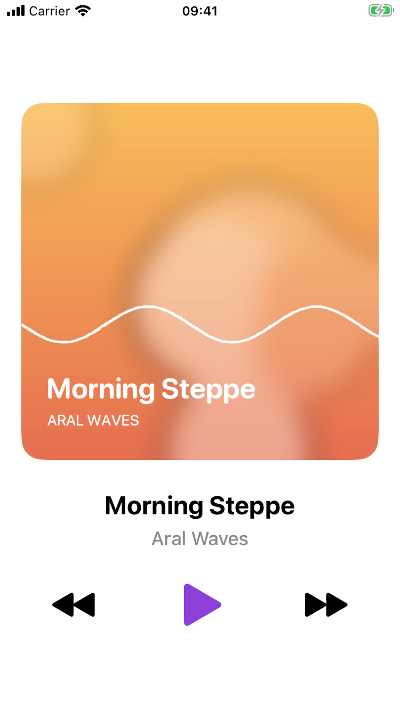
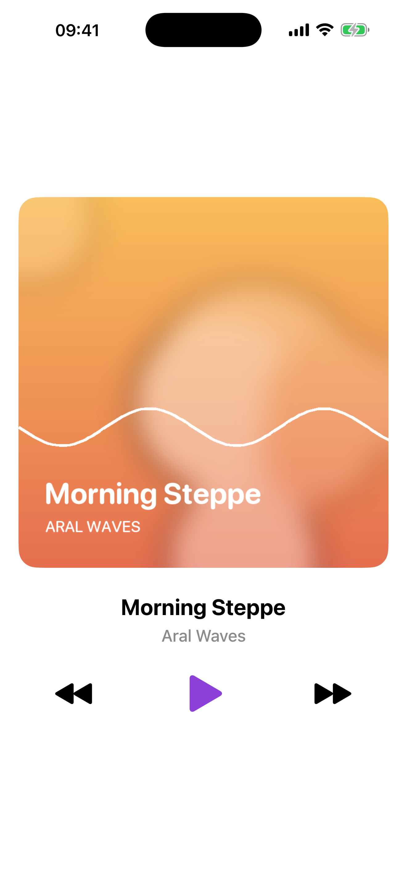

# Music Player

Lab · Music Player — UIStackView & Auto Layout. A single-screen UIKit player: track cover, title, artist and Previous / Play-Pause / Next buttons that play real audio files bundled with the app.

## Screenshots

| iPhone SE (3rd gen) | iPhone 16 Pro Max |
|---|---|
|  |  |

Screen recording (28 s, iPhone SE): play → next → next → previous ×3 (wraps from the first track to the last) → next (wraps back to the first) → pause: [Screenshots/demo.mp4](Screenshots/demo.mp4). The Simulator recorder does not capture sound.

## Requirements checklist

**Layout (Main.storyboard only)**
- Vertical root `UIStackView` → cover `UIImageView`, a vertical stack with the title and artist labels, a horizontal stack with the three buttons (3 stack views)
- Root stack: leading/trailing 20 pt to the Safe Area, vertically centered
- Cover keeps 1:1 with one aspect-ratio constraint (height = width)
- Only 4 constraints in the whole screen; no layout code in Swift (no `NSLayoutConstraint`, anchors, frames or `addSubview`)
- Zero Auto Layout warnings, no "Unable to simultaneously satisfy constraints" in the console
- SF Symbols: `backward.fill`, `play.fill` / `pause.fill`, `forward.fill`

**Track data**
- 10 tracks, each with its own `.m4a` file (≈400 KB) in `MusicPlayer/Audio/` and its own cover in `Assets.xcassets`
- Files are inside the app target's synchronized folder, so they are copied into the bundle
- `Track` struct: `title`, `artist`, `fileName`, `coverImageName`; the list lives in one place, `TrackLibrary` (`Track.swift`)
- Royalty-free: the music was generated from scratch for this project with a small synthesizer script (chords, bass and melody), so there are no third-party rights

**Playback (AVAudioPlayer)**
- `Bundle.main.url(forResource:withExtension:)` + `AVAudioPlayer`
- Play/Pause toggles playback and the icon
- Next / Previous update cover, title and artist and keep the play state
- The list wraps around in both directions
- `audioPlayerDidFinishPlaying` starts the next track automatically
- Missing file or a broken file does not crash: the optional URL and the `try` are handled with a clear `print`
- The player is a stored property of the view controller; the current index and play state live in one place and `updateUI()` refreshes the whole screen after every tap

## Personal playlist (local only)

`TrackLibrary.myPlaylist` describes my own playlist. Its audio and covers live in `MusicPlayer/MyMusic/`, which is in `.gitignore`, so they stay on my Mac and are never pushed. When that folder is missing (like in this repository) the app plays the 10 royalty-free tracks above, so the project runs with no extra setup.

## Project structure

```
MusicPlayer/
├── PlayerViewController.swift   // outlets, actions, AVAudioPlayer + delegate
├── Track.swift                  // Track struct + TrackLibrary
├── Audio/                       // 10 × .m4a
├── Assets.xcassets              // 10 covers, AppIcon, launch logo
├── Main.storyboard
└── LaunchScreen.storyboard
```

## How to run

Open `MusicPlayer.xcodeproj`, pick an iPhone simulator and press **⌘R**. No extra setup.
