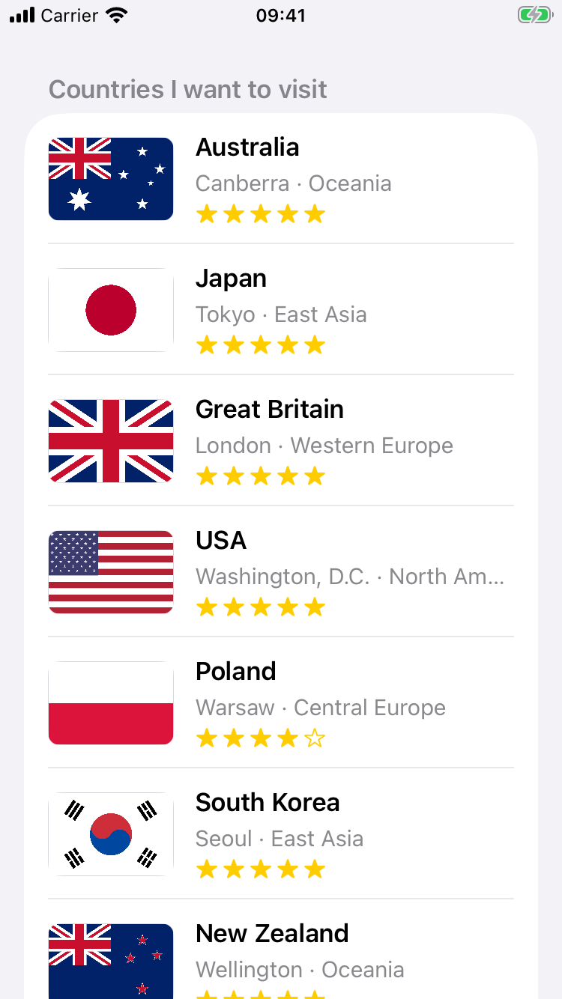
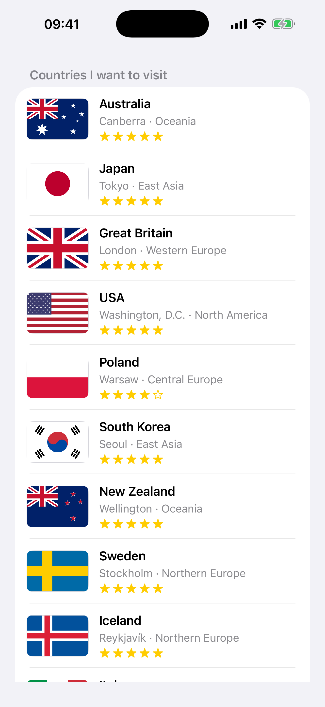

# Favorites List · Countries I Want to Visit

Lab · Favorites List — UITableView & Custom Cells. A UIKit app with a list of 20 countries I want to visit. Each row is a custom cell with the flag, the country name, the capital and region, and a rating from 0 to 5 stars that shows how much I want to go there.

## Screenshots

| iPhone SE (3rd gen) | iPhone 16 Pro Max |
|---|---|
|  |  |

Screen recording, scrolling through the whole list: [Screenshots/scroll.mp4](Screenshots/scroll.mp4)

## Requirements checklist

**Theme and data**
- Theme: countries I want to visit, 20 items
- Each item has a title, a subtitle, an image and a rating 0–5
- `FavoriteItem` struct, the array lives in one place: `FavoritesLibrary.items` (`FavoriteItem.swift`)
- Every country has its own flag image in `Assets.xcassets` (drawn for this project)

**Custom cell**
- `FavoriteCell: UITableViewCell` in its own file, only `@IBOutlet`s and `configure(with:)`, no layout code
- Flag `UIImageView` with a fixed size (84 × 56)
- Title and subtitle `UILabel`s
- Rating: a horizontal stack of 5 SF Symbol image views (`star.fill` / `star`), connected as an outlet collection

**Table view**
- One `UITableView` pinned to the Safe Area
- Prototype cell inside the table view in `Main.storyboard`, class `FavoriteCell`, reuse identifier `FavoriteCell`
- `UITableViewDataSource`: one row per item, `dequeueReusableCell(withIdentifier:for:)` cast to `FavoriteCell`
- Every dequeued cell is fully reset from its item

**Layout (Main.storyboard only)**
- Flag on the left; a vertical stack with title, subtitle and the rating row on the right
- Constraints only on the image and the outer stack; the stack is pinned top-to-bottom, so the row height follows the content
- Long titles wrap (`Lines = 0`) and never overlap the flag
- Zero Auto Layout warnings, no constraint conflicts in the console, checked on iPhone SE (3rd gen) and iPhone 16 Pro Max

## Project structure

```
FavoritesList/
├── FavoritesViewController.swift   // table view data source
├── FavoriteCell.swift              // custom cell: outlets + configure(with:)
├── FavoriteItem.swift              // struct + the 20 countries
├── Assets.xcassets                 // 20 flags, AppIcon, colors
├── Main.storyboard
└── LaunchScreen.storyboard
```

## How to run

Open `FavoritesList.xcodeproj`, pick an iPhone simulator and press **⌘R**.
